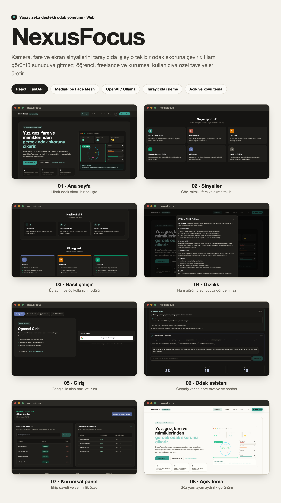

# NexusFocus: Yapay Zeka Destekli Hibrit Odak Yönetim Sistemi

NexusFocus, kullanıcıların çalışma verimliliğini artırmak için kamera, fare ve ekran sinyallerini yapay zeka ile analiz eden modern bir üretkenlik platformudur. Gizlilik odaklı tasarımıyla, verileri buluta göndermeden tarayıcı üzerinde işleyerek kişiselleştirilmiş odak tavsiyeleri sunar.

---

## 📸 Tanıtım ve Görseller



### 📥 [**Detaylı Tanıtım Sunumu (PDF)**](./docs/sunum/SUNUM.pdf)

---

## 🚀 Temel Özellikler

NexusFocus, üç farklı çalışma profiline özel modüller sunar:

*   **🎓 Öğrenci Modülü:** Ders çalışma ve okuma odaklı. Sabitlik ve anlama düzeyini takip eder.
*   **💻 Freelance Modülü:** Derin çalışma (Deep Work) ve akış (Flow) odaklı. Fare hareketleri ve ekran değişimlerini analiz ederek "Bilişsel Donma" anlarını tespit eder.
*   **🏢 Kurumsal Modül:** Takım verimliliği ve ergonomi odaklı. Anonimleştirilmiş ekip raporları ve yorgunluk uyarıları sunar.

### Öne Çıkan Fonksiyonlar:
*   **Canlı Odak Analizi:** Göz takibi ve mimik analizi ile anlık odak skoru.
*   **AI Odak Asistanı:** Geçmiş verilerinize dayanarak size mola ve çalışma planı öneren akıllı sohbet botu.
*   **Hibrit Takip:** Sadece kamera değil, fare hızı ve ekran etkileşimlerini de kapsayan bütünsel bir veri modeli.
*   **Karanlık ve Aydınlık Mod:** Modern ve göz yormayan şık arayüz seçenekleri.

---

## 🛠️ Kullanılan Teknolojiler

### Backend
*   **FastAPI:** Yüksek performanslı Python API çatısı.
*   **WebSocket:** Gerçek zamanlı veri akışı ve anlık analiz.
*   **SQLAlchemy & SQLite:** Hafif ve hızlı veri yönetimi.
*   **OpenAI / Ollama:** Yapay zeka destekli odak danışmanlığı.

### Frontend
*   **React + Vite:** Hızlı ve modern web arayüzü.
*   **Tailwind CSS:** Esnek ve premium tasarım sistemi.
*   **MediaPipe (FaceMesh & Iris):** Tarayıcı tabanlı düşük gecikmeli yüz ve göz takibi.
*   **Lucide React:** Modern ikon seti.

---

## 📦 Kurulum ve Çalıştırma

Projeyi yerel ortamınızda çalıştırmak için aşağıdaki adımları izleyin:

### Gereksinimler
*   Python 3.10+
*   Node.js 18+
*   Webcam (Yüz takibi için gereklidir)

### 1. Backend Kurulumu
```bash
# Sanal ortam oluşturun (Önerilir)
python3 -m venv .venv
source .venv/bin/activate  # Windows için: .venv\Scripts\activate

# Bağımlılıkları yükleyin
pip install -r requirements.txt

# Sunucuyu başlatın
uvicorn backend.main:app --reload
```

### 2. Frontend Kurulumu
```bash
# Frontend dizinine gidin
cd frontend

# Bağımlılıkları yükleyin
npm install

# Geliştirme sunucusunu başlatın
npm run dev
```
Uygulama varsayılan olarak `http://localhost:5173` adresinde çalışacaktır.

---

## 🔒 Gizlilik Notu
NexusFocus, **Privacy-First (Önce Gizlilik)** prensibiyle çalışır. Kamera görüntüleri hiçbir sunucuya kaydedilmez veya gönderilmez. Tüm görüntü işleme işlemleri MediaPipe aracılığıyla yerel olarak tarayıcınızda gerçekleşir.

---

## ✉️ İletişim
Geliştirici: **msalihtysz**
E-posta: [msalihtysz@gmail.com](mailto:msalihtysz@gmail.com)
GitHub: [msalihtysz](https://github.com/m-salihtysz)
